# TraceMind

企业级 RAG 知识库：员工用中文提问，系统在**自己有权看到的知识库**里召回、重排并给出带引用的回答，每一句结论都能回到原文页；召回链路逐阶段可追踪，检索参数可以用标注题集自动评测和调优。Claude Code、Cursor 等 AI Agent 也可以通过 MCP，以员工本人的身份使用同一套能力。

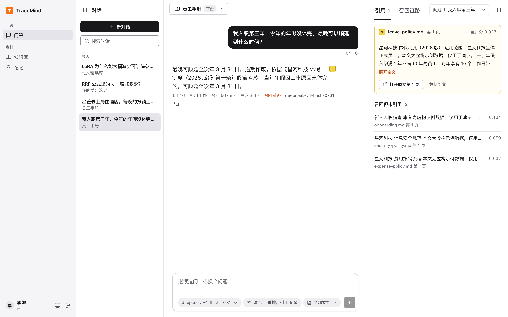

- **可追踪的召回链路**：范围过滤 → 查询改写 → 向量 / BM25 多路召回 → 加权 RRF 融合 → 重排 → 去重 / MMR / 相邻块扩展，每个阶段记录耗时、参数和候选，问答、评测、MCP 返回的是同一份 trace。
- **评估与调优闭环**：带页级证据标注的题集，Hit@k / Recall@k / MRR@10 / nDCG@10 排行榜，一键把最优配置设为知识库默认；调优同一任务内复用 Embedding 与重排结果，加候选几乎不加费用。
- **平台级与个人级**：知识库分平台（全员可用、管理员维护）与个人（仅本人，管理员也看不到），员工往平台库上传文档要管理员审批；长期记忆只属于本人，供 MCP Agent 使用。
- **审计**：管理员可查看查询日志（平台库记录问题原文，个人库只记元数据）和 MCP 调用日志（参数只留编号与长度）。
- **MCP**：Streamable HTTP + stdio，个人访问令牌鉴权，28 个工具覆盖召回、文档上传/更新/删除、记忆增删改查与合并、审批与调优。
- **界面**：参照 AskData UI kit（CC Switch v7 风格）：中性灰白为底，黑白做主操作，品牌橙只用于标记、开关和焦点环；黄色只留给证据（引用、高亮、选中的证据卡）。系统字体栈、13px 正文，浅色 / 深色 / 跟随系统三种主题（侧栏底部切换）。216px 单侧栏：问答、知识库、记忆在上，评测、审批、员工账号、审计日志、设置平铺在下，侧栏不显示数字；模块子页是页头下的下划线 Tab。表格一律左对齐、数字等宽；列表卡片撑到距窗口底边 120px，超过一页才出现分页条（页码、省略号、跳至）；通知是右下角 4 秒自动消失的卡片；设置页有未保存的修改时，离开前询问「放弃并离开 / 继续编辑 / 保存并离开」。对话页提问为右侧深色气泡，回答为左侧正文，召回链路按阶段着色并显示耗时占比，账户页可一键复制 MCP 客户端配置。
- **工程化**：PostgreSQL 持久任务队列，零停机文档替换，Alembic 迁移；后端 359 个测试（含真实 PostgreSQL + Milvus 的端到端测试），前端 Playwright 回归。

## 目录

- [系统架构](#系统架构)
- [核心技术方案](#核心技术方案)
- [运行截图](#运行截图)
- [Benchmark](#benchmark)
- [部署](#部署)
- [账号与权限](#账号与权限)
- [MCP 接入](#mcp-接入)
- [模型配置](#模型配置)
- [测试](#测试)
- [项目结构](#项目结构)
- [边界](#边界)

## 系统架构

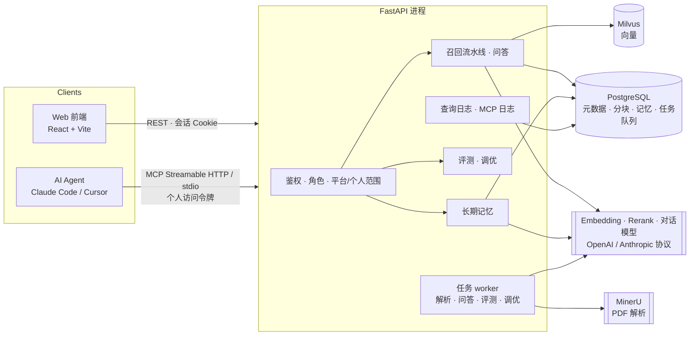

一次问答经过的链路（`backend/app/services/retrieval.py`、`rag.py`），每一步都写进 trace：

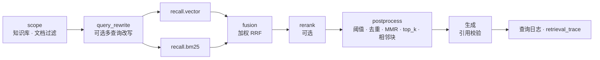

技术栈：Python 3.13 · FastAPI · SQLAlchemy 2 (async) · Alembic · PostgreSQL · Milvus 2.6 · MinerU 3 · MCP Python SDK；React 18 · TypeScript · Vite · TanStack Query · Radix UI · PDF.js；样式只引用 `frontend/src/styles/tokens.css` 中的设计令牌（浅色 / 深色两套取值）。

## 核心技术方案

### 1. 召回流水线

旧的 `bm25 / vector / hybrid / hybrid_rerank` 方法都映射成一份 `RetrievalConfig`，任何组合都可以在问答、检索对比、评测和 MCP 中直接传入：

| 阶段 | 可调参数 |
| --- | --- |
| scope | 知识库、`document_ids` 文档过滤；只检索已审批且就绪的文档 |
| query_rewrite | `none` / `multi_query`（对话模型改写成多个查询，每个查询各走一遍召回） |
| recall | `routes`（vector、bm25）、每路 `route_k` |
| fusion | 加权 RRF：`bm25_weight`、`vector_weight`、`rrf_k`、`fusion_k` |
| rerank | 开关；`min_score` 只作用于重排分数 |
| postprocess | 近重复去除 `dedupe_threshold`、MMR `mmr_lambda`、`top_k`、相邻块扩展 `neighbor_window` |

分数只在同一阶段内可比。相邻块扩展写进 `context_before/after`，不改被引用的 `text`，所以证据指标仍按原分块计算。生成阶段要求模型只引用实际提供的片段编号，返回前逐条核对；检索不到依据时回答"无法从资料中确认"。

### 2. 评估与调优

- **题集**：页级证据标注（`document_id` 或可移植的文件名 `doc_id` + 原文引文），JSONL / CSV 导入或手工维护；参考答案和证据只用于判分，不进索引也不进提示词。
- **批量评测**：多方法对比，冻结题目、知识库版本和模型快照；逐题落库，可暂停、恢复、只重试失败；可选模型裁判，缺失的裁判记为未评分而不是 0。
- **检索调优**：纯检索、不生成答案。按"题目外层、配置内层"执行，同一任务内复用查询向量、改写和重排分数；排名依次看目标指标 → nDCG → Hit@1 → Recall@5，从不看耗时（缓存会让先跑的配置更慢）。
- **指标口径**：被召回分块包含标注引文即视为相关（词法证据代理，不冒充人工相关性金标）。nDCG 每条证据只计一次、每个名次最多计一次，因此不会超过 1。

### 3. 长期记忆

- 每个账号一个命名空间 `user:<账号ID>`，只供本人的 MCP Agent 写入和召回。向量与记录同存 PostgreSQL（`REAL[]`），精确余弦 + BM25 做 RRF，重要度带 ±10% 权重；Embedding 不可用时按关键词检索，之后可 `reembed`。
- 写入按规范化文本和向量相似度去重（`skip / update / insert`），更新带 `expected_version` 乐观锁，合并生成新记忆并把来源标为 `merged`，每次变更写入 `memory_events` 审计（含前后快照）。
- 网页问答和 `rag_answer` 不读取记忆；记忆由 Agent 通过 `memory_search` 自行召回并注入提示词。
- Worker 按间隔检查记忆数量，超过阈值时用对话模型合并相近条目、归档低价值条目，管理员可在“记忆 / 自动整理”查看和手动触发。

### 4. 权限、审批与审计

- 每个接口先算出调用者能看到的范围：平台库全员可见、仅管理员管理；个人库、会话、个人记忆只属于本人，对其他人（包括管理员）一律 404，不暴露是否存在。
- 员工上传到平台库的文档进入 `pending_review`，**审批前不解析、不入向量库**，只有上传者和管理员可见；驳回会删除原文件。
- 查询日志：平台库记录问题原文，个人库只记录账号、时间、知识库、字数、结果数和耗时。MCP 日志对每次工具调用记录账号、令牌、工具、状态、耗时，参数只保留编号、数值、文本长度和文件扩展名。
- 密码加盐 scrypt，HttpOnly 会话 Cookie；首次登录强制改密；登录失败限流；停用账号立即使会话和令牌失效。

### 5. 文档生命周期

- PDF 交给 MinerU 解析，Markdown / TXT 直接入库；解析、分块、Embedding、索引各阶段状态可见，失败可重试。
- **零停机更新**：新版本作为独立文档入库，就绪后才删除旧版本；新版本失败时旧版本继续可检索。
- 删除先标记 `deleting`（立即退出检索），再依次删向量、分块、记录和文件，每一步都可重复执行。
- PostgreSQL 任务队列分通道处理解析、问答、评测、调优，解析不会阻塞已就绪文档的问答；重启后自动接续。

## 运行截图

截图使用 `scripts/seed_demo.py` 灌入的示例数据（虚构公司"星河科技"的员工手册 + 四篇公开论文）。

| 召回链路：每个阶段的耗时占比、参数与候选 | 知识库：平台库与个人库、文档就绪进度 |
| --- | --- |
| 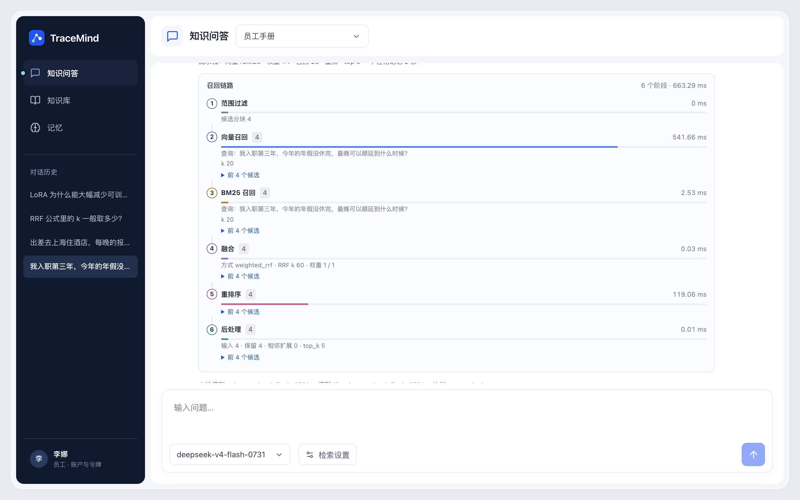 | 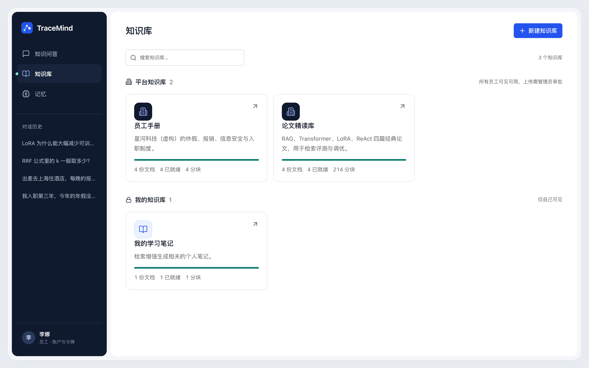 |
| **员工上传到平台库：等待管理员审批** | **文档详情：原始 PDF 与解析分块并排** |
| 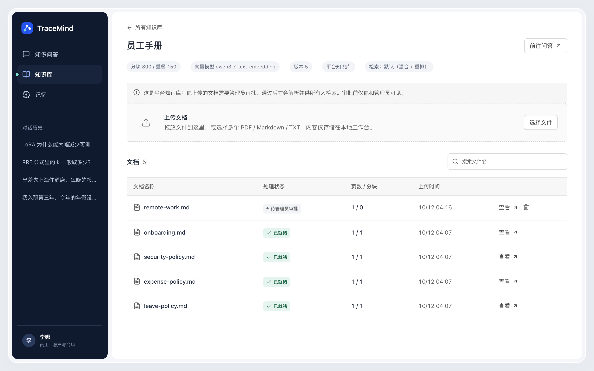 | 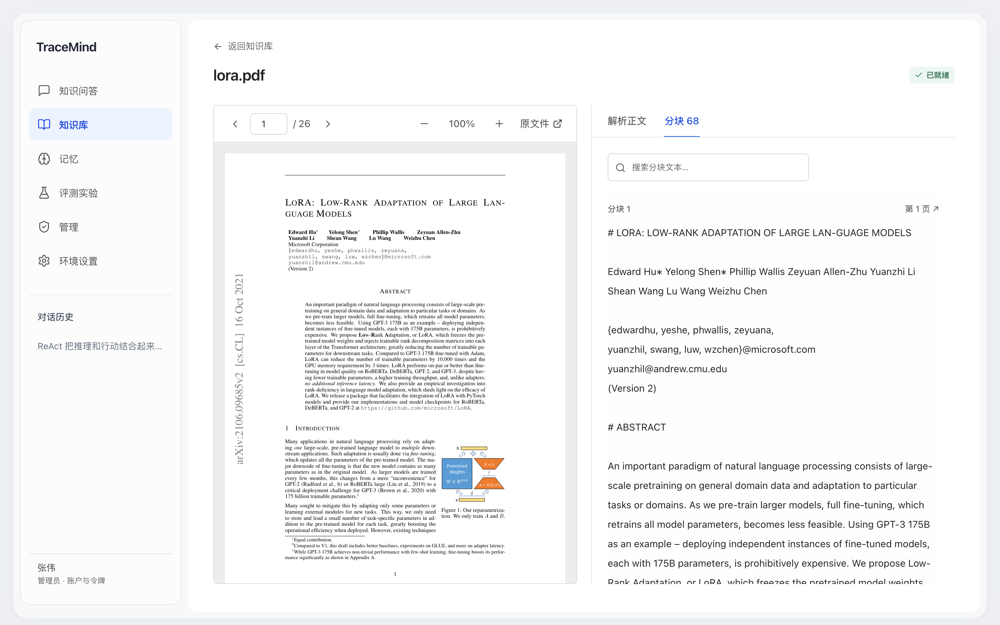 |
| **检索调优排行榜** | **批量评测：BM25 vs 混合重排** |
| 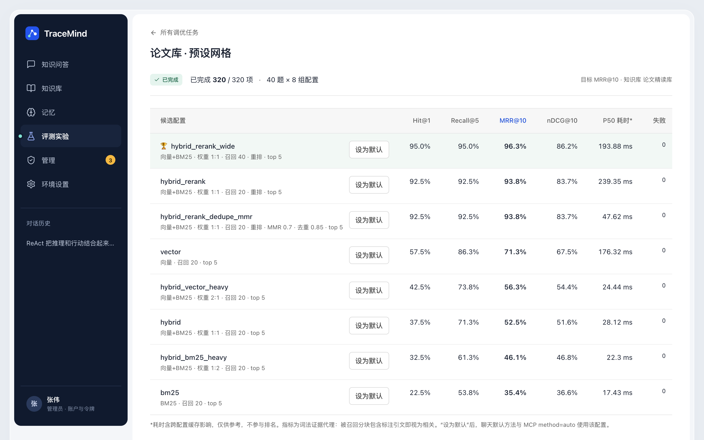 | 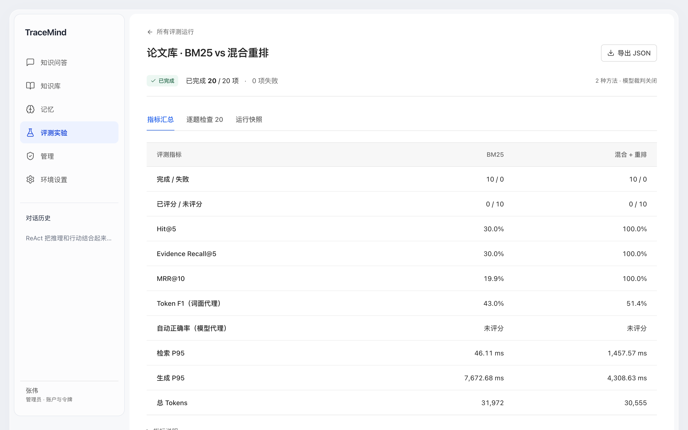 |
| **我的记忆** | **管理：待审批的文档** |
| 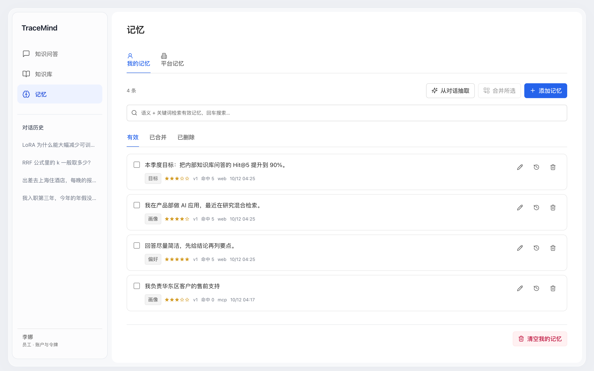 | 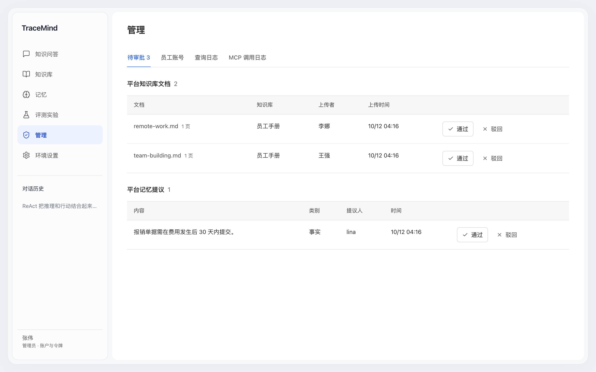 |
| **查询日志：个人库不记录问题原文** | **MCP 调用日志** |
| 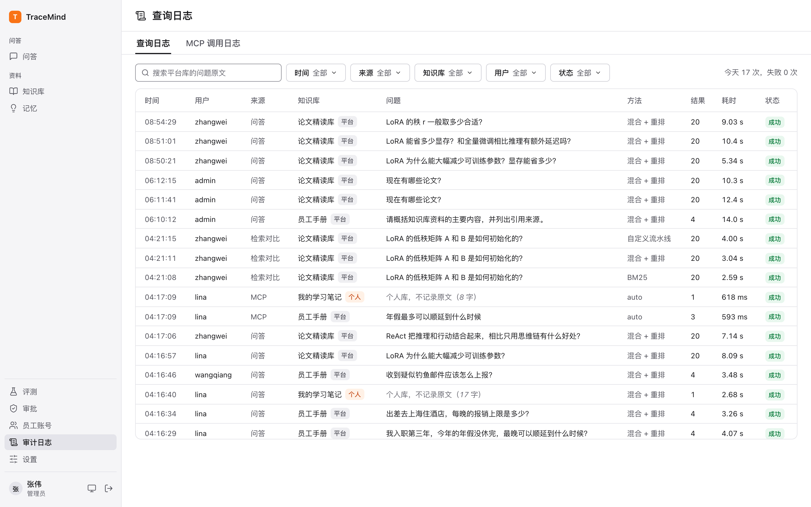 | 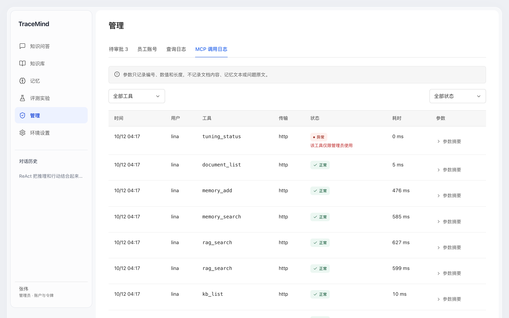 |
| **员工账号管理** | **我的账户：MCP 令牌与可复制的客户端配置** |
| 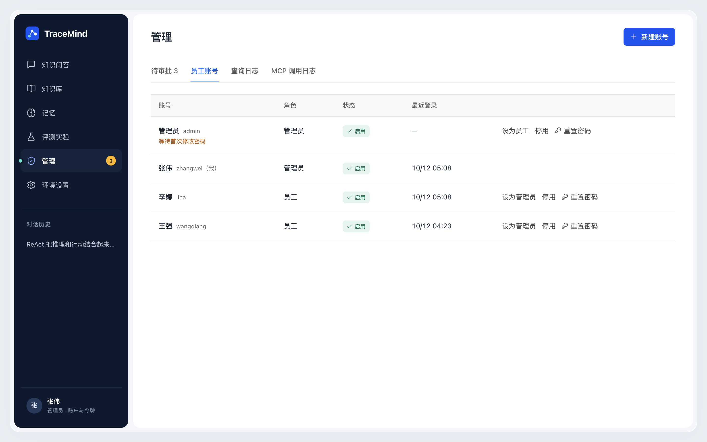 | 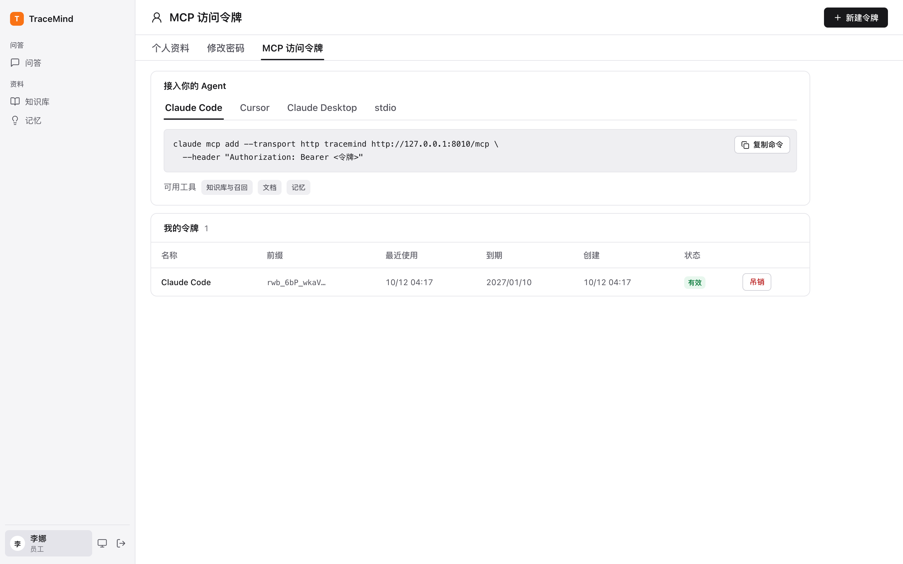 |

**登录页**

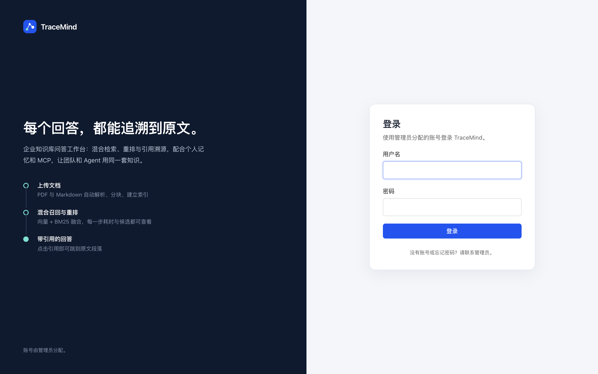

## Benchmark

语料是四篇公开论文（Attention、LoRA、RAG、ReAct，MinerU 解析为 214 个分块），题集为 100 道中文问题（`examples/questions.jsonl`，90 道可回答，带页级英文证据）。Embedding `qwen3.7-text-embedding`，重排为 DashScope Rerank，对话模型 `deepseek-v4-flash`。

**检索调优**（前 40 道题 × 8 组配置，纯检索）：

| 配置 | Hit@1 | Hit@5 | Recall@5 | MRR@10 | nDCG@10 |
| --- | --- | --- | --- | --- | --- |
| 混合 + 重排，召回 40（最优） | **95.0%** | **97.5%** | **95.0%** | **96.3%** | **86.2%** |
| 混合 + 重排，召回 20 | 92.5% | 95.0% | 92.5% | 93.8% | 83.7% |
| 混合 + 重排 + 去重 + MMR | 92.5% | 95.0% | 92.5% | 93.8% | 83.7% |
| 仅向量 | 57.5% | 90.0% | 86.3% | 71.3% | 67.5% |
| 混合，向量权重 2:1 | 42.5% | 77.5% | 73.8% | 56.3% | 54.4% |
| 混合，等权 | 37.5% | 75.0% | 71.3% | 52.5% | 51.6% |
| 混合，BM25 权重 1:2 | 32.5% | 65.0% | 61.3% | 46.1% | 46.8% |
| 仅 BM25 | 22.5% | 55.0% | 53.8% | 35.3% | 36.6% |

**端到端评测**（前 10 道题，生成答案）：

| 方法 | Hit@5 | Evidence Recall@5 | MRR@10 | Token F1 | 检索 P95 | 生成 P95 |
| --- | --- | --- | --- | --- | --- | --- |
| BM25 | 30.0% | 30.0% | 19.9% | 43.0% | 46 ms | 7.7 s |
| 混合 + 重排 | **100.0%** | **100.0%** | **100.0%** | **51.4%** | 1.46 s | 4.3 s |

结论与注意：

- 中文问题检索英文论文时，BM25 的字面重合很少，单独使用效果差；向量召回补上语义，重排决定头部排序，Hit@1 从 37.5%（不重排）提升到 92.5%。召回宽度从 20 提到 40 还能再涨约 2.5 个点。
- 用这份题集调参后，它就不再是独立的留出集；结果只说明本语料上的相对差异。指标是词法证据代理，Token F1 是词面重合，均不是人工评分。题目和证据由 AI 助手逐页编写，尚未经过独立人工复核（见 `examples/manifest.json`）。

## 部署

需要 **uv、Node.js 20+、pnpm、Docker**。PostgreSQL、Milvus（含 etcd / minio）和 MinerU 都在 `deploy/compose.yml` 的 `rag-workbench` 组里，由启动脚本拉起。

```bash
python3 scripts/init_env.py          # 生成 backend/.env 与 deploy/.env，已存在时不覆盖
# 在 backend/.env 中填写模型配置（首次启动导入数据库，之后在设置页修改）
./scripts/dev.sh                     # 启动依赖容器、迁移数据库、API + worker、前端

cd backend && .venv/bin/python -m app.cli create-admin --username admin
# 打印一次性临时密码，首次登录强制修改
```

| 服务 | 地址 |
| --- | --- |
| 页面 | <http://127.0.0.1:5174> |
| API 文档 | <http://127.0.0.1:8010/docs> |
| MCP | <http://127.0.0.1:8010/mcp> |
| PostgreSQL | `127.0.0.1:25432` |
| Milvus | `127.0.0.1:29530` |
| MinerU | `127.0.0.1:28000`（CPU 版 `mineru-api` 3.x，首次构建会下载 PyTorch 与模型） |

示例数据（会调用已配置的模型，产生少量费用）：

```bash
python3 scripts/fetch_papers.py                       # 从 arXiv 下载四篇论文并校验 SHA-256
cd backend && .venv/bin/python ../scripts/seed_demo.py
# 账号：zhangwei（管理员）、lina、wangqiang（员工），密码写入 data/demo-accounts.txt
```

- 停止依赖：`docker compose --env-file deploy/.env -f deploy/compose.yml stop`。不要使用 `down -v`，除非确实要删除数据库和向量数据。
- 只用 Markdown / TXT 时可以不启动 MinerU。macOS 上 Docker 无法使用 GPU，MinerU 容器只走 CPU；需要加速时可在宿主机直接运行 `mineru-api`（Apple Silicon 支持 MPS）。
- 忘记密码：`.venv/bin/python -m app.cli reset-password --username <用户名>`。
- 密钥只在服务端：`backend/.env`、`deploy/.env`、`data/.secrets/` 都被 Git 忽略。数据库中的模型密钥用 `data/.secrets/configuration.key` 加密，**备份数据库时必须一起备份这个文件**。

## 账号与权限

| | 管理员 | 员工 |
| --- | --- | --- |
| 账号 | 创建账号（系统生成临时密码）、设角色、停用、重置密码；不能停用或降级自己，至少保留一名启用的管理员 | 由管理员分配，首次登录必须改密 |
| 平台知识库 | 创建、管理、直接上传；审批员工上传 | 可见、可问答检索；上传需审批 |
| 个人知识库 | 自己的 | 自己的（管理员也看不到） |
| 个人记忆 | 仅本人 | 仅本人 |
| 评测、调优、检索对比、环境与模型设置 | 可用 | 不可见 |
| 查询日志、MCP 调用日志 | 可见 | — |

评测和调优只能针对平台知识库：结果由所有管理员共享，个人库的内容不应借此被他人看到。

## MCP 接入

在「我的账户 → MCP 访问令牌」新建令牌（只显示一次），Agent 以你的身份调用，权限与网页一致：

```bash
claude mcp add --transport http tracemind http://127.0.0.1:8010/mcp --header "Authorization: Bearer rwb_..."
```

| 分组 | 工具 |
| --- | --- |
| 知识库与召回 | `whoami` `kb_list` `kb_create` `kb_set_retrieval_config` `rag_search` `rag_answer` |
| 文档 | `document_list` `document_get` `document_upload` `document_update` `document_delete` |
| 记忆（`scope` = personal / platform） | `memory_add` `memory_search` `memory_list` `memory_get` `memory_update` `memory_delete` `memory_restore` `memory_merge` `memory_history` `memory_extract` `memory_clear` |
| 审批（管理员） | `review_list` `review_decide` |
| 评测调优（管理员） | `dataset_list` `tuning_start` `tuning_status` `tuning_apply` |

stdio 方式、完整参数和推荐的 Agent 流程见 [docs/mcp.md](docs/mcp.md)；真实链路冒烟：`RAG_MCP_TOKEN=rwb_... backend/.venv/bin/python scripts/smoke_mcp.py`。

## 模型配置

设置页可保存多个对话模型，支持 **OpenAI Chat Completions、OpenAI Responses、Anthropic Messages** 三种协议，不限定供应商；Embedding、Rerank（DashScope 原生或 Standard `/rerank`）、MinerU、Milvus 都可在线修改。

- 保存和测试分开：保存不调用模型，"测试模型"需要再次确认，可能计费。API Key 只写不读，留空保留，显式勾选才清除。
- 新消息和评测入队时冻结所选模型快照，之后编辑或归档模型不影响已提交任务。
- 更换 Embedding 模型/维度/地址或 Milvus 集合后，旧知识库会拒绝不兼容的索引，需要新建知识库重新上传，不会静默混用向量。
- 首次启动从 `backend/.env` 导入以下字段，之后以设置页为准：

```dotenv
CHAT_BASE_URL=https://dashscope.aliyuncs.com/compatible-mode/v1
CHAT_MODEL=...
CHAT_API_KEY=...
EMBEDDING_BASE_URL=https://dashscope.aliyuncs.com/compatible-mode/v1
EMBEDDING_MODEL=...
EMBEDDING_API_KEY=...
EMBEDDING_DIMENSIONS=1024
RERANK_BASE_URL=https://dashscope.aliyuncs.com
RERANK_MODEL=...
RERANK_API_KEY=...
```

接口细节见 [docs/model-configuration-api.md](docs/model-configuration-api.md)，完整 REST 约定见 [docs/api-contract.md](docs/api-contract.md)。

## 测试

```bash
cd backend
uv run pytest -q                                                    # 单元与接口测试，无外部依赖
RAG_DB_TEST=1 uv run pytest -q tests/test_auth_postgres.py tests/test_memory_postgres.py   # 真实 PostgreSQL，独立租户
RAG_CONFIG_DB_TEST=1 uv run pytest -q tests/test_configuration_postgres.py               # 事务回滚
RAG_E2E_TEST=1 uv run pytest -q tests/test_mcp_e2e.py   # PostgreSQL + Milvus 全流程，模型为确定性假实现
cd ../frontend
pnpm exec playwright test                               # 接口全部 mock，不产生费用
pnpm build
```

- 后端 359 个测试：召回流水线与指标、迁移脚本、模型协议适配、配置加密、账号/会话/令牌、权限隔离、审批、日志，以及 MCP 端到端（管理员与员工两种身份、审批、两类日志、参数不落正文）。
- `frontend/tests/workspace.spec.ts` 读取真实数据，需要 `RAG_QA_USERNAME` / `RAG_QA_PASSWORD`，未设置时跳过。
- README 截图：`node frontend/scripts/readme-screenshots.mjs`（需先运行 `seed_demo.py`）。

## 项目结构

```text
backend/app/api/          REST 接口：auth、admin、library、chat、memory、evaluation、tuning、settings
backend/app/services/     检索流水线、问答、入库、向量、记忆、评测、调优、鉴权、访问控制、审计
backend/app/mcp_server.py MCP 工具（挂载于 /mcp，也可 stdio 运行）
backend/app/worker.py     PostgreSQL 持久任务队列（解析 / 问答 / 评测 / 调优 / 记忆整理通道，含定时记忆整理）
backend/app/cli.py        create-admin、reset-password
backend/migrations/       Alembic + upgrade/downgrade SQL
frontend/src/             React 页面：问答、知识库、记忆、评测、管理、账户、设置
deploy/                   PostgreSQL、Milvus、MinerU 的 docker compose
examples/                 论文题集与 manifest、员工手册与演示文档（论文 PDF 需用脚本下载）
scripts/                  初始化、启动、示例数据、论文下载、冒烟测试
docs/                     MCP、REST、模型配置文档与 README 截图
```

## 边界

- 这是带账号、两级角色和审计的内网工作台，不是可直接开放到公网的 SaaS：应用和数据库只绑定 loopback，来源与 Host 受限；没有自助注册、密码找回邮件、SSO 或多因素认证。公网部署前还需要 HTTPS、上传配额、多实例任务租约和独立安全测试。
- 向量与 BM25 两路都在 Milvus 中检索（BM25 用 jieba 分词、小写、去标点，建集合时固定），分块原文按命中 ID 从 PostgreSQL 读取，不整库加载；BM25 的词频统计覆盖整个集合，其他知识库的内容会影响本库打分。单库默认上限 20,000 块。集合结构变化时用 `python -m app.reindex --collection <新集合>` 重建并切换，旧集合保留。
- 页码是解析页锚点，不提供 PDF 字符级高亮；对话使用阶段状态轮询，不做假流式。
- 示例论文版权归原作者，仓库不附带 PDF；来源与版本见 `examples/manifest.json`。
